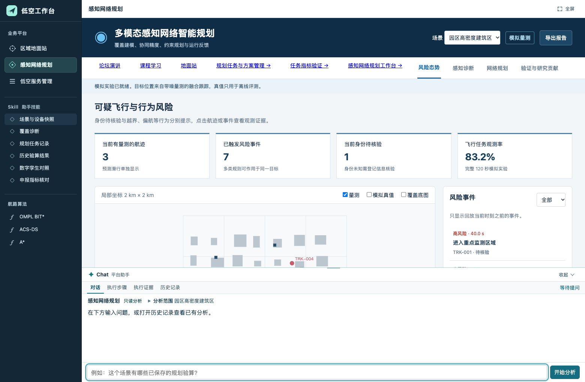

# UAV 低空区域飞行管理与多模态感知网络规划平台

本仓库保存低空平台的前后端、研究算法、测试、部署配置和操作文档。
当前主要用于本地仿真、ArduPilot SITL 与研究验证；不代表真实设备集成或现场指标验收完成。

## 系统组成

| 路径 | 内容 |
| --- | --- |
| `platform/app`、`platform/static` | 感知网络规划、覆盖与融合跟踪、方案评价、示范应用、数据安全柜和学习功能 |
| `platform/ubuntu/flight` | 地面站、二维/三维地图、飞行仿真、SITL、遥测、航路与计算调度、回放 |
| `platform/ubuntu/lowair` | 资源、申请审批、任务调度、执行回执和业务监管 |
| `research/data_security_cabinet` | 安全柜必需的加密、授权、远程证明、检查点和对象存储实现 |
| `research/noncoop`、`research/planning` | 非合作目标及规划研究原型 |
| `platform/tests`、`platform/ubuntu/*/tests` | 后端、前端逻辑与验收测试 |
| `platform/docs`、`platform/deploy` | 设计、部署及运行说明 |

请保持以上相对目录。安全柜由平台直接导入 `research/data_security_cabinet`，不能只复制 `platform` 运行。

## 本地启动

建议使用 Python 3.12，将虚拟环境放在 iCloud 等同步目录之外。在仓库根目录执行：

```sh
python3 -m venv /tmp/uav-venv
/tmp/uav-venv/bin/python -m pip install -r platform/requirements-dev.txt -r platform/ubuntu/flight/requirements.txt -r platform/ubuntu/lowair/requirements.txt
SENSE_PYTHON=/tmp/uav-venv/bin/python SENSE_SERVICE=flight bash platform/scripts/run.sh
```

打开 [统一工作台](http://127.0.0.1:8772/)，从左上切换区域地面站、感知网络规划和低空服务管理。左下列出现有只读 Skill 和航路算法。中央业务页面支持全屏和还原。底部 Chat 可以查看执行步骤、证据及历史记录。

独立业务页面分别位于 `/station`、`/network/`、`/service/`。如本地配置了 `SENSE_PORT=8894`，可以用 [8894 工作台入口](http://127.0.0.1:8894/) 访问。



也可分别设置 `SENSE_SERVICE=planning` 或 `lowair` 启动独立服务，默认端口为 8767、8771。
使用 `SENSE_DATA_DIR`、`FLIGHT_DATA_DIR`、`LOWAIR_DATA_DIR` 分别配置数据目录；独立与挂载业务服务应明确使用同一数据归属。
SITL、视频推理、算法扩展、课程资料和安全柜外部服务需要各自的依赖与资源，详见 [平台说明](platform/README.txt)。

## 上传范围与外部资源

本次同步保留原系统代码和设计文档。数据库、用户记录、密钥、主机凭据、虚拟环境、缓存、运行日志和生成结果不上传。
课程仅保留目录及来源元数据，原始 PDF 和逐页译文需按授权在本地准备；新克隆不包含完整课程阅读资源。
模型权重、测试视频、SITL 二进制和运行中生成的策略文件需依照对应脚本准备。
第三方代码、地图与建筑数据保留来源和许可证；具体限制以各组件附带文件为准。

## 验证及已知限制

在相应目录执行 `python -m pytest tests -q`。前端使用 Node 测试，部分测试另需服务、报告夹具或浏览器。
原工作区本轮检查：规划 85 项、业务服务 22 项、前端逻辑 72 项通过；地面站 144 项通过后在视频集成等待中手动中止，不能称为全量通过。

上传副本另通过地面站基础、设备适配与规划证据关联的 10 项后端测试，以及 76 项前端逻辑测试。
其中两项回放测试需要通过 `COMPUTE_REPLAY_FLOW=/绝对路径/sitl-flow.json` 提供真实生成的仿真回放夹具；本次使用原工作区已有夹具。运行证据不随源码上传，新克隆需先执行相应回归生成夹具，不能直接将缺少夹具时的失败视为完整验收结果。

原有容器配置尚未跟上当前挂载架构：flight 镜像缺少 lowair 源码及外层 research 安全柜依赖，挂载业务的数据卷也未统一；修复前不将 Docker Compose 视为已验证启动方式。
业务与飞控接口尚未提供统一生产鉴权，监管事件采集部分依赖页面请求，真机控制尚未开放。仿真、历史建筑参考层和测试视频结果不能代替实地测量或安全认证。
