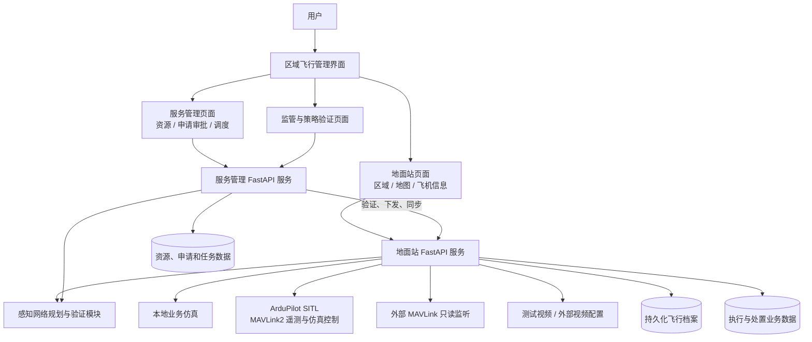

# 低空区域飞行管理系统设计

编制日期：2026-11-12；核心定位校正：2026-11-13  
文档性质：依据当前前后端实现整理的系统设计与交付边界。  
适用范围：区域飞行管理、低空资源与任务服务、安全监管、策略验证、地面站控制、数字孪生及飞行记录管理。

## 1. 系统定位与统一口径

本项目是**一个以航路规划、云边端协同计算算法实现与可视化为核心的低空区域飞行管理系统**。主流程应为“区域与约束建模 → 航路规划 → 云边端协同计算 → 联合评估 → 仿真执行与回放”。资源审批、监管、地面站和飞行档案是支撑模块，不能取代算法主线。

2026-11-13 核查发现：当前实现重点仍偏向地面站与执行管理；已有航线避障、感知覆盖及简单资源调度基线，但完整云边端任务卸载模型和算法可视化尚未完成。详见 [航路规划与云边端协同计算设计核查](航路规划与云边端协同计算设计核查.md)。下文保留已有工程模块的实现说明，首页的信息优先级与算法建设按本次核查调整。

系统只有一个产品定义和一套持续完善的设计，不按页面修改批次划分产品。服务管理、监管与策略验证、地面站是系统内部的功能模块；本地仿真、ArduPilot SITL、外部 MAVLink 是运行数据来源。模块、数据来源和二维/三维显示方式均不代表不同系统。

首页以区域态势为中心，采用“**左侧区域与任务、中间地图、右侧飞机控制与信息**”布局。巡检是用户可以创建的任务，不作为系统首页固定的业务前提；初始页面不自动解锁、起飞、执行巡检或注入预警。

系统当前主要在仿真环境验证业务与执行流程。外部飞控已提供只读遥测接入；真实飞控控制、真实机载视频及其严格时间同步仍需后续接入与验证。

## 2. 使用对象与职责

| 使用对象 | 核心工作 | 页面侧重点 |
| --- | --- | --- |
| 区域管理人员 | 选择管理区域，维护资源，查看任务与飞行态势 | 区域、资源、任务状态和统计 |
| 任务申请与审批人员 | 提交飞行申请，审核用途、飞机、飞手和航线 | 申请、审批、验证结果 |
| 飞行操作人员 | 查看飞机状态，下发允许的操作，核对回执与实际状态 | 地面站、仪表、地图和控制 |
| 监管与处置人员 | 发现预警，关联任务，验证处置路线，记录处置结果 | 预警详情、约束、航迹与证据 |
| 测试与运维人员 | 运行仿真、验证链路、检查记录保存和服务状态 | 数据来源、诊断、历史任务 |

以上是职责划分。当前演示接口中的申请人、审核人、处置人等业务字段，不能视为已经完成生产级身份认证和角色授权。统一账号、组织权限和操作审计需要专项接入。

## 3. 总体架构



### 3.1 模块与部署对应

| 模块 | 主要代码位置 | 默认访问方式 | 职责 |
| --- | --- | --- | --- |
| 地面站与区域态势 | `platform/ubuntu/flight/app/` | `http://127.0.0.1:8772/` | 地图、仪表、控制、巡检、预警处置、孪生与回放 |
| 低空服务管理 | `platform/ubuntu/lowair/app/` | `http://127.0.0.1:8772/service/` | 资源、申请审批、任务验证和调度 |
| 安全监管与验证页面 | 同上 | `/service/safety`、`/service/validation` | 查看监管状态、任务与验证信息 |
| 感知网络规划与验证 | `platform/app/` | 地面站内挂载 `/network`；也可独立运行于 8767 | 感知规划、地图资源、策略计算与验证支撑 |
| 飞行档案 | `flight/app/sitl_business.py` | 业务任务校验、执行意图、SITL 准备与执行关联查询 |
| `flight/app/flight_records.py` | `/api/sitl/records` | 独立任务档案、分页查询和历史遥测读取 |

系统统一入口为 `http://127.0.0.1:8772/`，服务管理挂载在同一端口的 `/service/`，规划模块挂载在 `/network/`。各页面统一使用“低空区域飞行管理系统”名称，模块职责保持清晰。独立运行服务管理进程仅作为部署选项；当前仍未实现生产级统一登录。

### 3.2 当前技术组成

- 后端采用 Python、FastAPI、Pydantic，使用 HTTP JSON 接口组织业务。
- 地面站前端采用 HTML、CSS 和原生 JavaScript；二维地图使用 Leaflet，三维场景使用 Three.js。
- 卫星影像、建筑数据和地图坐标工具由地图及规划相关模块支撑；影像可用性取决于数据源与网络。
- ArduPilot SITL 由专用本机进程运行，后端通过 pymavlink 读取遥测并执行仿真指令。
- 当前地面站主要采用轮询刷新，SITL 孪生约每秒读取一次状态；不是全链路 WebSocket 推送系统。
- 业务及档案采用 SQLite 持久化；飞行档案使用独立数据库和事务写入。

## 4. 前端信息架构与页面布局

### 4.1 首页结构

```text
┌───────────────────────────────────────────────────────────────────────┐
│ 顶部：系统/地面站入口、区域任务入口、必要的模块导航、连接状态             │
├────────────────┬────────────────────────────────┬─────────────────────┤
│ 左侧：管理对象  │ 中间：区域地图                 │ 右侧：选中飞机      │
│                │                                │                     │
│ 运行数据来源   │ 卫星底图 / 二维 / 三维          │ 状态与连接信息      │
│ 管理区域       │ 监管区域边界                   │ 飞行仪表            │
│ 飞机选择       │ 仿真禁飞区                     │ 可用控制与回执      │
│ 区域任务       │ 飞机、计划航线、实际航迹       │ 视频与来源说明      │
│ 必要图层设置   │ 预警、定位、跟随、范围缩放     │ 历史任务与回放      │
│                │                                │ 按需查看任务详情    │
├────────────────┴────────────────────────────────┴─────────────────────┤
│ 底部/地图状态条：高度、速度、航向、电量、位置及数据状态                   │
└───────────────────────────────────────────────────────────────────────┘
```

当前主要桌面布局使用左侧约 220 px、右侧约 330 px、中间自适应的三列结构。具体宽度由样式和窗口尺寸决定。

### 4.2 左侧：区域、飞机与任务

左侧用于确定“管理哪里、查看哪架飞机、关联哪个任务”，不承担姿态仪表和视频显示。

1. 选择运行数据来源：本地仿真、SITL 三维孪生、外部飞控只读监视。
2. 选择管理区域，定位区域边界并查看区域内的约束。
3. 在本地仿真中选择机队飞机；SITL 当前对应专用实例 `SITL-1`，不将本地机队飞机冒充 SITL。
4. 创建区域巡检任务。创建任务、航线检查和上传，与解锁、起飞、执行任务分别表达。
5. 图层、坐标配置及辅助说明默认收纳，避免长文本占据首页。

### 4.3 中间：地图与态势

地图是首页主体，初始应突出管理区域及周边地理环境，不自动进入某次巡检的局部镜头。

| 地图对象 | 表达方式 | 交互与含义 |
| --- | --- | --- |
| 监管区域 | 蓝色虚线边界、区域名称 | 定位和查看区域用途；区域边界不等同飞行围栏 |
| 仿真禁飞区 | 红色边界/填充、明确的“仿真禁飞区”标签 | 二维点击查看名称、高度范围、用途；不表示真实发布空域 |
| 计划航线 | 青色航线 | 展示任务航点及高度，与实际航迹区分 |
| 实际/仿真遥测航迹 | 绿色实线等明确区分的样式 | 来源随当前飞机和实时/回放状态显示 |
| 飞机 | 二维标记或三维飞机模型 | 当前飞机定位、跟随；三维展示位置和姿态 |
| 预警与冲突 | 预警标识、冲突位置和相关路线 | 在对应监管/任务功能中查看关联信息 |
| 历史位置 | 历史状态标签或灰色提示 | 不作为当前实时位置使用 |

图例和辅助视角采用可展开控件。监管说明放在监管功能面板，避免长条说明遮挡主地图。地图可展开或收起侧边信息，并在尺寸变化后重新计算布局。

三维禁飞区目前主要以高度范围边线和标签呈现；二维详情弹窗的能力不能直接等同为所有三维对象都已具备同样的拾取交互。

### 4.4 右侧：地面站操作与返回信息

右侧围绕当前数据来源组织内容，显示仪表、状态、允许的控制、回执、视频和回放。不同数据来源对应不同控制权限，不能同时把多组按钮呈现为同一架飞机的操作。

- 仪表：姿态、航向、相对高度、地速、电量及有效性提示。
- 飞机状态：连接、飞行模式、解锁状态和关键遥测。
- 控制：依当前适配器及状态显示允许的操作；回执与遥测完成状态分别显示。
- 视频：明确来源；未接入时显示未连接，失败时不使用其他画面冒充。
- 历史：任务选择、刷新/分页、播放/暂停、时间拖动、返回实时。

## 5. 运行数据来源与控制边界

| 数据来源 | 地图和仪表来源 | 可用控制 | 记录与用途 |
| --- | --- | --- | --- |
| 本地仿真 | 系统内业务仿真状态 | 本地仿真指令、任务与处置流程 | 验证区域业务和监管联动 |
| ArduPilot SITL | 专用 SITL 的 MAVLink2 遥测 | 指向本机 SITL 的引导、解锁、起飞、执行、悬停、返航、降落等操作 | 验证飞控回执、飞行过程、三维孪生与持久化回放 |
| 外部 MAVLink | 外部监听器收到的心跳、位置、姿态等 | 当前只读，无真实飞控控制权 | 验证真实接入接口；来源须由操作者确认 |
| 历史回放 | 选定任务的持久化快照 | 不发送飞行指令，锁定相关操作 | 分析历史姿态、航迹和仪表 |

外部 MAVLink 数据也可能来自另一套仿真器。收到心跳不意味着已经识别为真实飞机；系统不根据“连接成功”自动切换控制对象。

当前面向硬件的指令适配器未启用，请求会明确拒绝，不会悄悄回退到仿真。目标硬件方案为 STM32F405 芯片的 ArduPilot 飞控，配合光流、GPS、磁罗盘，通过 MAVLink2 与任务机通信；具体固件板型、参数和实际传感器融合效果仍需实机验证。

## 6. 功能模块设计

### 6.1 资源管理与飞行业务

资源包括机场/起降设施、飞机、挂载和飞手。服务管理后端负责资源有效性、申请数据、审批结果、任务生成及状态保存。

业务链路为：


业务任务可以选择本地仿真或 SITL 执行。SITL 链路为“批准申请 → 生成业务任务 → 验证 SITL 航线 → 准备 SITL 执行 → 在地面站显式控制 → 同步执行状态 → 从任务读取关联档案”。SITL 准备仅上传，不解锁、不起飞；批准航线必须满足当前坐标原点、建筑、禁飞区、围栏与电量检查，不允许静默替换航线。真实飞机控制仍未接入。

### 6.2 区域巡检

巡检任务绑定区域和执行对象，包含航线检查、上传/装订、执行、暂停/继续、模拟异常、处置和结果查询。

- 本地巡检通过 `/api/park-patrol` 管理。
- SITL 巡检通过 `/api/sitl/patrol/upload` 和专用控制接口执行。
- 一键演示通过 `/api/sitl-demo` 编排，属于明确标注的仿真流程。
- 巡检航线检查考虑当前仿真建筑、禁飞区和飞行约束；`TEMP-BARRIER` 等约束不能因演示方便而关闭。
- 任务创建/航线上传不等于起飞授权。状态变化应以回执与观测到的飞行状态共同确认。

### 6.3 安全监管与处置

监管模块展示任务、飞行器、空域约束、预警及处置过程。预警详情关联任务、航迹和相关验证信息，处置前可预览返航或降落路线并进行安全检查。

动态仿真覆盖新增飞行器、禁飞区变化、多机冲突、路线重规划和暂停原因展示。处置及回放应保留原路线、调整后路线、冲突位置和原因，方便解释决策。

当前上述能力主要基于本地仿真、已配置约束和演示目标；尚不能等同于真实多传感器全天候监管，也不能视为已完成真实飞行器的自动拦截。

### 6.4 数字孪生

数字孪生用遥测驱动地图中的飞机对象，并与仪表和轨迹共享状态。其关键是“同一对象、同一坐标定义、可追溯的数据来源和时间”，而不是仅增加三维建筑。

当前 SITL 三维孪生已实现：

1. WGS84 经纬度转换到地图使用的局部 ENU 坐标。
2. 飞控相对高度驱动模型高度及仪表读数。
3. 航向、俯仰和横滚共同驱动飞机姿态；场景采用适配后的 YXZ 旋转顺序。
4. 显示任务航线、航迹、仿真区域和禁飞区边线，支持定位与跟随。
5. 关键位置或姿态过期时，不继续显示为有效实时三维飞机。
6. 回放时用历史快照替换显示数据，不修改正在运行的飞机状态。

外部飞控目前主要为二维遥测孪生和仪表只读监视，不能将 SITL 三维验证结果直接视为外部实机三维链路已全部验收。

### 6.5 视频与监控画面

| 类型 | 当前能力 | 使用边界 |
| --- | --- | --- |
| FFmpeg 测试流 | 浏览器展示 MJPEG 测试图案，支持开启/停止 | 独立于飞机，不作为巡检或目标识别证据 |
| 本地合成帧 | 根据仿真数据形成流程展示画面 | 不是机载相机视频 |
| 外部视频配置 | 通过 `TWIN_VIDEO_URL` 和 `TWIN_VIDEO_SYSTEM_ID` 绑定浏览器可播放地址与飞机系统号 | 需单独配置和验证；RTSP 需视频网关 |
| 历史视频同步回放 | 尚未实现 | 遥测回放时停止测试流，不冒充同期录像 |

## 7. 坐标、时间与数据质量

### 7.1 坐标定义

- 地理位置使用 WGS84 经纬度。
- 局部坐标为 X 向东、Y 向北、Z 向上，单位为米。
- SITL 与局部场景通过同一地理原点转换。
- 目前三维地面按平面基准展示，飞行高度使用相对起飞面的高度；不能混用海拔、相对高度和离地高度。
- 每份飞行档案保存自身坐标原点；选择历史任务后，不使用当前任务的原点替代。
- 卫星影像、建筑数据和航迹需要在同一坐标体系核对。尚未建立完整的实测地形/测绘高程基准。

### 7.2 时间定义

实时状态包含字段更新时间，飞行记录包含服务端采样时刻 `at` 和各字段年龄 `field_age_s`。这是接收端快照时间，不代表所有传感器已在硬件级严格同步。

历史回放以同一游标选择不晚于该时刻的采样，位置、姿态、仪表和已走过的航迹由同一快照生成。当前不生成未经标注的姿态或位置插值。

### 7.3 缺失与过期处理

关键字段约 3 秒内有效；过期或缺失时显示未知/不可用，不补造零值或切换为其他数据来源。历史时段出现数据缺口时标记缺失。没有字段时效信息的已有记录应明确提示其限制。

建筑轮廓和高度的数据覆盖、精度及来源需要单独说明。当前三维显示不代表已获得雄安全域真实建筑模型、实测高度或倾斜摄影场景。

## 8. 飞行档案与统一回放

### 8.1 档案生命周期


新任务不复用旧档案编号。任务完成后、正常停止或切换任务时补存。重启 SITL、后端及创建新任务不会删除已保存记录。

异常退出后，上一会话未完成的记录在目录中标记为中断，不标为完成。在磁盘正常的情况下，异常退出仍可能丢失最后约 5 秒未提交的数据；写入异常通过 `record_error` 暴露。

### 8.2 物理存储

档案使用独立 SQLite 数据库 `flight-records.sqlite3`，包含：

| 表 | 核心字段 | 用途 |
| --- | --- | --- |
| `flights` | `id`、`created`、`updated`、`boot`、`status`、`body` | 任务元数据、会话、坐标原点、航线及关联回执 |
| `frames` | `flight_id`、`at`、`body` | 按任务和时间保存遥测快照，联合主键防重复 |

元数据与帧使用事务保存。内存使用有限滚动窗口，已经入库的历史帧不因内存窗口滚动而删除。

标准启动脚本默认将档案放在 `platform/ubuntu/flight/data/flight-archives/`，可通过 `FLIGHT_RECORDS_DIR` 指定位置。直接使用 uvicorn 启动时，应显式传入同一目录。当前目录查询和回放为只读管理，未实现档案删除、自动清理、归档导出产品页面或保留期策略。

### 8.3 档案数据结构

```json
{
  "record_id": "独立记录编号",
  "source": "ardupilot-sitl",
  "anchor": {"latitude": 39.05, "longitude": 115.98},
  "patrol": {"area_id": "west", "status": "completed", "route": []},
  "track": [
    {
      "at": 0,
      "latitude": 39.05,
      "longitude": 115.98,
      "altitude": 40,
      "roll": 0,
      "pitch": 0,
      "yaw": 90,
      "speed": 5,
      "battery": 80,
      "armed": true,
      "field_age_s": {"roll": 0.1, "latitude": 0}
    }
  ],
  "receipts": [],
  "video_evidence": null
}
```

以上是字段示例，不是实测结果。`at` 在实际数据中为采样时间戳。

### 8.4 回放交互

1. 选择历史飞行任务，加载该任务固定快照。
2. 初始停在首帧，点击播放按记录时间前进。
3. 点击暂停或拖动时间轴，停止推进并显示对应采样。
4. 航迹只显示到当前历史时刻，三维姿态与仪表使用同一帧。
5. 播放至末尾停止；可重新播放或返回实时。
6. 返回实时读取当前遥测，不恢复、启动或取消飞行任务。
7. 回放期间锁定 SITL 控制；暂停回放不等于让正在飞行的 SITL 悬停。
8. 实时轮询继续维护实时缓存，但不能覆盖当前历史画面；异步历史请求也不能在用户切换来源后重新激活回放。

业务任务号 `task_id`、SITL 执行编号 `execution_id` 与飞行档案号 `record_id` 保持独立并显式关联。执行绑定持久化保存在 `sitl_executions` 表；档案保存 `business_task_id`、`execution_id`、`business_vehicle_id` 和 `validation_id`。从任务打开执行或回放时携带任务上下文，不展示其他任务的实时飞机，也不接受不匹配的档案。SITL 演示运行编号仍属于独立演示流程，不冒充业务任务。

## 9. 后端接口分组

以下为当前主要接口，不替代完整接口定义。除特别说明外，请求及响应以对应 Pydantic 模型和实现为准。

### 9.1 服务管理接口（统一入口前缀 `/service`）

| 方法与路径 | 职责 |
| --- | --- |
| `GET /api/resources` | 查询机场、飞机、挂载、飞手资源 |
| `PUT /api/resources/{resource_id}` | 更新资源 |
| `GET/POST /api/applications` | 查询、提交申请 |
| `POST /api/applications/{id}/review` | 审批申请 |
| `POST /api/tasks/from-application/{id}` | 由申请生成任务 |
| `POST /api/tasks/{id}/validate` | 验证任务 |
| `POST /api/tasks/{id}/dispatch` | 下发业务任务 |
| `POST /api/tasks/{id}/sync` | 同步执行状态 |
| `POST /api/tasks/{id}/validate-sitl` | 验证批准任务在 SITL 中的执行条件 |
| `POST /api/tasks/{id}/prepare-sitl` | 幂等准备 SITL 执行，不解锁、不起飞 |
| `GET /api/tasks/{id}/execution` | 获取关联执行状态和档案回放地址 |
| `GET /api/safety` | 汇总监管信息 |

### 9.2 地面站与执行接口（默认 8772）

| 方法与路径 | 职责 |
| --- | --- |
| `GET /api/station/state` | 本地地面站综合状态 |
| `GET/PUT /api/mavlink` | 外部监听状态、监听配置 |
| `GET /api/twin` | 外部遥测只读孪生投影 |
| `GET /api/sitl` | 专用 SITL 状态 |
| `POST /api/sitl/start` | 启动或连接受管理的本机 SITL |
| `POST /api/sitl/patrol/upload` | 检查并上传 SITL 巡检航线 |
| `POST /api/sitl/commands` | 执行带编号和有效期的 SITL 指令 |
| `GET /api/sitl/patrol/result` | 当前会话巡检结果 |
| `GET /api/sitl/records?limit=30&offset=0&task_id=TASK-…` | 分页查询持久化档案，可按业务任务筛选 |
| `POST /api/sitl/business/validate` | SITL 批准航线执行前检查 |
| `POST /api/sitl/business/prepare` | 持久化执行意图并上传航线 |
| `GET /api/sitl/business/tasks/{task_id}` | 查询执行及关联档案 |
| `POST /api/sitl/business/tasks/{task_id}/cancel` | 取消当前未解锁的准备任务 |
| `GET /api/sitl/records/{id}` | 读取指定任务的历史快照 |
| `GET /api/sitl-demo/catalog` | 区域、仿真禁飞区和演示对象目录 |
| `POST /api/sitl-demo/start`、`/cancel` | 仿真流程演示启动、中止 |
| `GET /api/test-video/stream` | 独立 MJPEG 测试视频 |

### 9.3 监管与验证接口（默认 8772）

| 方法与路径 | 职责 |
| --- | --- |
| `POST /api/business/validate/{vehicle_id}` | 本地业务执行条件验证 |
| `POST /api/business/dispatch/{vehicle_id}` | 本地业务任务下发 |
| `GET /api/business/situation` | 监管态势 |
| `GET/PUT /api/business/airspace` | 查询、修改仿真空域约束 |
| `GET /api/business/incidents/{id}` | 查询预警与处置信息 |
| `POST /api/business/incidents/{id}/preview` | 预览处置路线与安全验证 |
| `POST /api/business/incidents/{id}/act` | 执行允许的仿真处置动作 |
| `POST /api/business/incidents/{id}/sync` | 同步处置结果 |
| `POST /api/business/simulation-traffic` | 注入仿真交通目标 |
| `POST /api/business/dynamic-demos` | 动态避障演示 |

### 9.4 指令与回执原则

控制请求包含唯一编号、动作、有效期及必要参数。绑定业务任务时还必须提供匹配的 `execution_id`；编号不匹配或业务执行已完成时拒绝操作。相同编号的重复请求应复用既有结果，编号相同但内容不同应拒绝。

ACK 表示指令接收/处理结果，不代表动作已经完成。起飞高度到达、悬停、降落和上锁需通过后续遥测确认。超时或结果不确定时不能自动当作成功，也不应无条件重复发送。

## 10. 代码职责划分

| 代码 | 设计职责 |
| --- | --- |
| `flight/app/static/index.html`、`gcs.css` | 首页结构和统一布局 |
| `gcs.js`、`gcs-core.js` | 地面站状态、基础交互、坐标工具 |
| `gcs3d.js` | 三维场景、飞机姿态、航线与区域图层 |
| `region-management.js` | 区域选择、地图范围与区域任务入口 |
| `sitl.js` | SITL 状态、专用控制和回执 |
| `sitl-twin.js` | SITL 快照、坐标映射、历史采样选择和场景数据 |
| `twin.js` | 数据来源切换、孪生面板、视频和统一回放交互 |
| `flight-instrument.js` | 飞行仪表绘制 |
| `patrol.js`、`supervision.js` | 巡检和监管交互 |
| `flight/app/sitl.py` | SITL 生命周期、MAVLink 遥测、任务与指令 |
| `flight/app/sitl_business.py` | 业务任务校验、执行意图、SITL 准备与执行关联查询 |
| `flight/app/flight_records.py` | 飞行档案事务写入、目录和详情接口 |
| `flight/app/mavlink_link.py`、`twin.py` | 外部飞控只读接入与有效性投影 |
| `flight/app/business.py`、`incidents.py`、`traffic.py` | 业务执行、预警处置与动态仿真 |
| `lowair/app/main.py`、`domain.py`、`store.py` | 服务业务接口、规则与持久化 |

路径中前端文件均位于 `platform/ubuntu/flight/app/static/`；服务模块位于 `platform/ubuntu/`。这些是实现组件，不是产品版本分类。

## 11. 部署与运行设计

### 11.1 启动入口

在 `platform/` 目录执行，Python 环境应放在 iCloud 目录之外并安装相应依赖：

```sh
SENSE_PYTHON=/path/to/venv/bin/python SENSE_SERVICE=flight bash scripts/run.sh
SENSE_PYTHON=/path/to/venv/bin/python SENSE_SERVICE=lowair bash scripts/run.sh
```

通常只需第一条命令，即可在统一入口访问地面站、服务管理和规划模块。第二条仅用于独立部署服务管理模块。`SENSE_PORT` 可覆盖端口；`FLIGHT_BASE_URL`、`PLANNING_BASE_URL` 配置服务间地址。

### 11.2 主要配置

| 配置项 | 用途 |
| --- | --- |
| `FLIGHT_RECORDS_DIR` | 持久化飞行档案目录，重启时必须保持一致 |
| `FLIGHT_DATA_DIR` | 地面站相关业务数据目录 |
| `LOWAIR_DATA_DIR` | 资源、申请、服务任务数据库目录 |
| `SENSE_DATA_DIR` | 规划模块数据目录 |
| `ARDUPILOT_SITL_BINARY` | SITL 可执行文件路径 |
| `SITL_TCP_PORT`、`SITL_INSTANCE` | 本机 SITL 专用连接与实例 |
| `TWIN_VIDEO_URL`、`TWIN_VIDEO_SYSTEM_ID` | 外部视频地址及飞机系统号绑定 |

当前 SITL 由单个后端进程管理，使用内存状态与专用实例。不能未经改造就使用多个后端 worker 或多副本同时控制同一 SITL。生产部署还需完善身份鉴别、连接权限、备份恢复、日志监测和容量管理。

## 12. 验收设计与当前结果

### 12.1 验收范围

| 验收项 | 通过条件 |
| --- | --- |
| 首页布局 | 区域、地图、飞机信息职责明确；说明不遮挡地图 |
| 来源切换 | 不混用仿真与外部遥测，不自动发送飞行命令 |
| 坐标与姿态 | 经纬度反算一致，高度口径一致，三轴姿态更新 |
| 数据过期 | 缺失或过期状态明确，实时飞机不继续伪装有效 |
| 控制闭环 | 请求、回执和观测到的完成状态可核对 |
| 回放时间轴 | 暂停、拖动、继续、返回实时均保持地图与仪表一致 |
| 持久化 | 重启后可读，新任务不覆盖旧任务 |
| 异常处理 | 无记录、无效编号、异步响应过期、存储失败可识别 |
| 视频 | 来源明确，回放不伪装同步录像 |

### 12.2 已完成验证

截至编制日，最近一轮地面站相关测试结果：

- 地面站 Python 测试 71 项、服务管理及跨服务 Python 测试 22 项、前端 Node 测试 36 项通过。
- 实际本机 SITL 完成起飞、巡检、自动降落并上锁，生成约 180 秒、750 帧记录。
- 通过持久化接口读取记录，抽查 108 个时刻，位置反算、姿态、仪表与航迹截止时间一致。
- 重启后端和 SITL，再创建另一区域任务，两条已完成档案的原点、航线和全部帧的内容校验值保持不变。
- 测试覆盖离线选择历史任务、分页、实时轮询不覆盖回放、异步请求竞态、回放控制锁定、增量写入及事务回滚等情形。

这些数字是本次仿真与自动化测试结果，不是外场飞行验证结果，也不能推断所有服务管理和监管页面均已在本轮完整复测。

**浏览器视觉验收尚未完成**：浏览器控制工具仍返回禁用，不能宣称已经完成真实浏览器的全部点击、布局和渲染验收。

### 12.3 测试入口与证据

在 `platform/ubuntu/flight/` 执行：

```sh
/path/to/venv/bin/python -m pytest tests -q
node --test tests/*.cjs
```

实际 SITL 验证脚本会操作专用仿真实例，应在确认没有其他任务运行时执行：

```sh
/path/to/venv/bin/python scripts/test_sitl_flow.py \
  --url http://127.0.0.1:8772 --report /tmp/sitl-report.json
node scripts/test_twin_replay.cjs /tmp/sitl-report.json
```

档案验证脚本只读查询：先记录已完成任务基线，在重启或新建任务后再次核对。

```sh
/path/to/venv/bin/python scripts/test_record_archive.py \
  --capture --baseline /tmp/records-baseline.json
/path/to/venv/bin/python scripts/test_record_archive.py \
  --baseline /tmp/records-baseline.json
```

当前证据文件位于项目根目录的 `outputs/ground-station-sitl/`：

- `2026-11-12-flight-archive-acceptance.json`
- `2026-11-12-flight-archive-baseline.json`
- `2026-11-12-flight-archive-replay-check.json`

## 13. 当前能力与后续完善边界

| 能力 | 当前状态 | 后续工作 |
| --- | --- | --- |
| 区域地图、仪表、飞机控制和任务展示 | 已有实现 | 补齐真实浏览器视觉与完整操作验收 |
| 资源、申请审批、业务调度 | 已有后端与页面 | 统一跨模块任务关联和权限 |
| 本地监管预警、避障和处置仿真 | 已有流程 | 实际数据接入、真实约束和更多故障场景验证 |
| SITL 三维遥测孪生 | 已实现并仿真验证 | 更平滑的展示、持续性能与长航时验证 |
| 飞行档案持久化与选任务回放 | 已实现并跨重启验证 | 档案检索、保留期、导出和备份恢复能力 |
| 业务任务统一关联 SITL 与档案 | 已建立持久化映射并完成仿真闭环 | 后续扩展真实设备、多实例执行和生产级权限 |
| 外部飞控 | 只读接入接口 | 实机验证、控制权管理、故障保护及授权控制 |
| 机载视频与时间同步录像 | 接口预留，未完整实现 | 视频网关、时间标定、录制与同步回放 |
| 雄安真实三维建筑和地形 | 数据与覆盖有限 | 按数据许可与可用性补齐，并核对精度 |
| 生产级身份权限与多实例部署 | 当前设计不能视为已完成 | 专项建设并进行部署验收 |

后续实现继续沿用本系统的页面结构、数据来源标识、任务上下文和接口职责，避免通过新增独立入口重复建设同类控制流程。


## 14. 业务任务关联执行的状态与操作约定

- 任务页按执行目标提供“验证本地仿真”或“验证 SITL”。不同目标的验证不能混用于下发。
- SITL 验证绑定业务任务、飞机资源、用途、批准航线、场景、当前原点和空域版本，并有有效期。准备时重新检查状态。
- `scheduled → dispatching → prepared → flying → completed` 为正常流程；其中 `prepared` 表示已上传、待操作，不能标为已飞行。
- 执行意图先持久化。同一任务、同一航线重复准备返回既有执行，不重复上传；相同任务改变航线会拒绝。超时/不确定结果不能自动重发飞行指令。
- 单个受管理 SITL 实例不能被多个未结束业务执行同时占用。已有业务绑定时，不允许独立巡检或演示覆盖该航线。
- 任务页自动同步活动 SITL 执行状态，提供“查看执行”“结果回放”和关联档案链接。准备任务可在未解锁时取消；飞行中通过地面站处置。
- 统一页面路径：`/` 为区域地面站，`/service/` 为服务管理，`/service/safety` 为监管页面，`/service/validation` 为验证页面；历史查询参数不会切换为另一套首页。
- 执行深链接：`/?source=sitl&task=TASK-…`；回放深链接：`/?source=sitl&task=TASK-…&record=…`。这些链接只选择显示上下文，不发出解锁、起飞等操作。
- 此处的任务关联约束不等同于生产级身份鉴权；当前仍是本机仿真验证系统。

业务到 SITL 的端到端仿真脚本为 `platform/ubuntu/flight/scripts/test_business_sitl_flow.py`，从批准申请开始，经验证、幂等准备、显式仿真飞行、任务同步，核对最终档案及回放链接。运行前应确认专用 SITL 没有其他活动任务。

本轮任务关联验收：从统一入口创建标注为仿真的资源与申请，经审批生成 `TASK-000021`；通过 SITL 验证后准备执行，重复准备返回同一执行编号且不重复上传。随后通过带匹配执行编号的控制请求完成本机 SITL 飞行、落地上锁和任务状态同步。关联档案含 165 帧，生产回放适配器逐帧核对位置、姿态与高度通过。重启后，任务、执行、档案及监管来源仍保持一致。业务任务页可用 `/service/?tab=tasks&task=TASK-000021` 直接定位；该地址只选择任务，不启动飞行。

本轮证据位于 `outputs/ground-station-sitl/2026-11-12-business-task-sitl-acceptance.json`、`2026-11-12-business-task-link-check.json` 和 `2026-11-12-business-task-replay-check.json`。浏览器视觉验收仍未完成，不能将接口与仿真测试视为实际浏览器布局验收。


## 2026-11-13 开源算法接入

在现有三栏地面站新增“航路与计算”入口，接入 OMPL BIT*、HATTO ACS-DS 独立模块和 HEFT 基线，提供航路、计算调度、对照指标和持久化实验可视化。完整近期论文联合优化尚未复现，不等于真实云边端执行。选型、源码版本、适配范围、限制和验收详见 [航路与云边端算法选型及复现](航路与云边端算法选型及复现.md)。

### 2026-11-13：算法规划接入业务执行

航路实验经完整起降航段安全检查后生成原服务平台申请，审批与任务调度保留算法编号；批准任务通过现有 SITL 验证/准备接口执行。执行绑定冻结计算配置，遥测每秒驱动 HEFT 独立批次并保存快照，地图、仪表和历史调度共用回放时间轴。保留原三栏布局，右侧新增折叠调度详情。实现边界、操作步骤及本轮实际 SITL 验收见《航路与云边端算法选型及复现》第 9 节。

### 本地多进程协同计算接入

在区域任务的算法执行绑定下增加可启动/停止的端、边、云进程运行时。协调器独立于 MAVLink 收包，实际执行固定合成图像 DAG，记录进程、依赖、实际耗时、结果摘要、失败及恢复。飞行档案关联实际执行快照与批次，原回放时间轴同时驱动飞机、仪表和计算证据；界面保留现有三栏，在调度折叠项内展示实测与预测。详细契约、故障边界及测试见《航路与云边端算法选型及复现》第 10 节。


### 测试录像检测与计算证据联动

云边端本地进程默认工作负载更新为 OpenCV 测试录像 + 官方 SSDLite MobileNetV3 COCO 检测。沿用原始地面站三栏布局、任务编号和飞行档案关联，右侧云边端折叠面板显示检测原始帧、叠加框、实测耗时和失败恢复；节点与阶段详情按需展开。测试流、SITL 遥测和真实机载视频严格区分。每批检测保存不可变帧与模型哈希，历史时间轴读取归档结果，不重新推理。具体安装、时序、素材来源及限制见《航路与云边端算法选型及复现》第 11 节。


### 实测调度反馈与节点故障恢复

实际端边云进程根据每类任务实测耗时 EWMA、最近执行槽负载和当前 SITL 位置更新 HEFT 成本。工作进程掉线会从候选集中排除，未完成任务使用协调器保存的同一输入迁移重试；节点自动或手动恢复后重新参与调度。每次派发保存候选成本、原因和修订号，掉线/恢复/迁移事件与检测帧按批次、执行编号关联到飞行档案，在既有时间轴回放。现有三栏不变，故障演示和成本详情均折叠。此阶段仅验证本地进程故障，不包含远程网络断链或协调器容灾。


### 弱网和断链仿真

在既有多进程协同计算中加入应用层上传/回传链路门控，支持全局带宽上限、单向时延下限、断链及自动/手动恢复。调度同时使用当前链路配置、SITL 位置和实测计算反馈；失败重试复用同一检测帧，最多三次尝试。链路事件、迁移、各阶段等待和检测结果随执行归档，在原时间轴同步回放。原三栏布局不变，操作位于已有故障演示折叠区。这里只仿真计算数据链路，不改变 MAVLink、系统网络或真实飞控；计算实测耗时与网络仿真等待分别展示。实现边界与验收命令见《航路与云边端算法选型及复现》第 13 节。


### 地图中的计算拓扑

原地图叠加端、边、云节点及弱网/断链状态；二维与三维采用同一历史游标投影。任务迁移以短暂紫色方向标识展示，与右侧负载、检测帧和历史时间轴联动。云为逻辑位置，连线和迁移偏移均为计算关系示意，不是飞行航线。节点点击使用已有计算面板，图例保持折叠，不新增首页面板。详见算法选型及复现文档第 14 节。

### 云边端一键故障演示与可追溯地图详情

原三栏布局保留；操作收在右侧“云边端调度 → 链路与节点仿真”。一键场景由后台协调器推进，刷新页面不依赖浏览器计时器。各阶段即时归档；支持中止恢复、100 秒有界超时，以及演示期间禁止冲突的独立故障注入。服务重启后读取归档，不自动重启故障注入。

点击链路显示方向、可用性、仿真带宽和时延、关联批次；点击迁移标识显示迁移阶段、各次尝试的失败原因、实测执行往返、仿真传输等待和对应检测帧。地图、仪表盘和证据详情共用历史游标。对尚未完成的结果不提前展示，禁止用其他批次最新画面替代迁移证据。具体复现命令和测试证据见《航路与云边端算法选型及复现》第 15 节。

### 历史回放事件导航

回放时间轴下提供折叠事件标记区，正常/弱网/断链/节点掉线/恢复及任务迁移均可点击定位。前端从已保存 runtime_history 构建去重索引，不查询实时网络状态推算历史。跳转以首个包含事件的持久化快照为准，并联动地图、飞机姿态、航迹、迁移尝试和检测结果；结果受游标时间及执行编号约束。缺少明确批次的状态事件显示说明；未完成检测不提前显示。返回实时清除选择，不发送飞控指令，保留现有页面布局。

### 2026-11-13：历史计算事件筛选与迁移对照

保持现有区域地面站三栏布局，在右侧历史飞行任务的“计算事件”内提供全部、正常、弱网、断链、节点掉线、任务迁移和恢复筛选。上一个／下一个仅遍历当前筛选结果；首尾禁用，不循环。同一保存时刻的多个事件按事件顺序逐个选择。跳转自动暂停回放，地图、姿态仪和计算证据共用保存快照时间；筛选本身不改变时间。

迁移详情以同一批次、同一阶段的相邻尝试对照节点、状态、执行往返、链路等待、总耗时和检测结果。明确区分本机实测与链路仿真；未完成或未采集为“—”，失败检测不伪造结果。未到批次完成时刻不显示最终检测证据。非检测阶段标明“非检测阶段”，下面的图像属于关联批次。回放为只读，不发送飞控或故障注入指令。

验收：53 项相关 Node 测试通过；Chrome 使用 TASK-000086 既有 SITL 档案完成筛选、前后事件、单事件边界、同刻多事件、拖动后结果更新、返回实时的实际操作验收。本轮未重新飞行。证据目录：`outputs/compute-replay-navigation/2026-11-13/`。

### 2026-11-13：新建任务的飞行中故障与保存后回放验收

新建 TASK-000099，经申请审批、BIT* 航路规划、安全验证、SITL 装订、起飞、AUTO 航线执行、返航落地与任务完成同步，生成档案 `2fca59d3daa24c94bb831f6bd56d2ff3`。调整 `scripts/test_process_sitl_flow.py --demo`，将五阶段计算演示放在 AUTO 执行确认之后，覆盖飞行中的正常、弱网、断链、节点掉线与恢复。执行完成 59 批计算、4 次重试恢复、0 批最终失败，保存 493 帧遥测、286 个计算快照和 14 个去重事件。测试视频为非机载录像，网络条件为应用层仿真。

新增 `scripts/test_compute_replay_archive.cjs <flow-report.json> <checks.json>`，对真实保存的本次仿真档案逐类检查筛选、导航边界、同刻事件顺序、地图节点/链路/迁移投影、迁移尝试与时延对应关系。通过 API 逐帧核对归档 JPEG 的 SHA256；检测使用现成 SSDLite 模型和端/边/云本地进程。

Chrome 实际打开新任务档案，完成六类筛选（含任务迁移）、前后跳转、同刻迁移与恢复切换、回放拖动、返回实时及重新读取。弱网 9.1s、断链 9.6s、掉线 15.0s、节点恢复 20.2s 均与地图联动；恢复时飞机约 120m，端节点重新在线。断链迁移 segment：edge-a → device，尝试总耗时 535ms → 107ms，关联检测 4 个目标。掉线迁移 preprocess：device → edge-a，总耗时 76ms → 138ms，关联检测 3 个目标。非检测阶段明确标识，检测图来自同批次最终结果。

发现并修复单次尝试详情将未采集 worker 耗时显示为 0ms 的问题，改为“—”，补充回归断言。修复后 53 项前端测试通过，3 项演示后端测试通过；新档案校验及浏览器复验通过。页面布局未变。

证据：`outputs/compute-new-task-e2e/2026-11-13/` 内含完整执行报告、日志、回放校验、测试日志和两张浏览器截图。

### 一键云边端回归入口（2026-11-13）

`scripts/run_compute_regression.py` 串联新任务创建、规划审批、安全检查、SITL 飞行中五阶段故障演示、落地归档、检测帧校验、回放事件与地图投影校验，以及读取本轮档案的前端交互测试。默认连接本机隔离服务 8773，生成独立时间戳目录下的 HTML/JSON 报告和分阶段日志；退出码 0 表示全部通过。页面布局不变。

新增 POST `/api/sitl/restart` 仅重启自管本机仿真，保留旧档案。运行中的仿真必须有已落地且未解锁的遥测，并且没有活动计算或演示；否则拒绝。用于解决连续回归时剩余电量导致新任务被拒绝的问题，保留原有电量与航线安全检查。回归入口拒绝非本机服务及同地址并发，阶段超时仅对匹配本轮执行标识的 SITL 请求降落并记录结果。失败保留日志和部分任务证据，不伪报完成。

实跑 TASK-000123 全部通过：64 批完成、3 次恢复重试、0 批失败；新档案 `f9897b11ddb84d9a8d914002cc4962ec`。21 项前端测试通过，入口及仿真重启/演示的 10 项后端测试通过。完整报告：`outputs/compute-regression/20261113-061907/report.html`。此前电量不足的失败报告保留用于验证失败路径。

该命令验证前端处理器与地图投影，不自动操控真实浏览器，也不声称完成截图视觉验收；需视觉检查时打开报告提供的本轮回放链接。运行说明见 `platform/README.txt`。

### 真实浏览器自动验收接入（2026-11-13）

一键回归在归档及前端处理器测试后执行 `scripts/test_compute_browser.py`。通过 Playwright 启动独立 Google Chrome（默认有窗口，可选 `--headless`），打开本轮 task_id/record_id 的历史回放；不使用页面内部函数驱动业务状态。

实际操作包括六类事件筛选、逐个前后跳转及首尾禁用、同刻不同事件切换、地图迁移标识键盘激活、时间轴拖动、返回实时及重新读取。地图链路和节点状态、关联批次、迁移前后节点与三类耗时、检测数量及对应图像 URL 均与本轮持久化证据比较；图片必须成功解码，未到完成时刻不得显示未来检测。记录页面异常及 API 非 GET 请求，回放产生控制请求即失败。

新增 browser.json/browser.log 和 browser-events.png、browser-migration.png；错误时保存 browser-failure.png。主 JSON 合并浏览器检查及错误，HTML 内嵌截图。浏览器失败使整轮退出非零，不会沿用前端单元测试的成功结论。截图前等待可见卫星瓦片加载，外部瓦片未齐单独列为 warning；不跳过业务图层和检测证据检查。

依赖固定在 `platform/ubuntu/flight/requirements-browser.txt`，Chrome 使用独立临时用户目录，不连接个人标签页。现有页面布局不变。

本轮默认有界面 Chrome 端到端实跑通过：TASK-000136 / d48029e5e0fc4b4faef9cad6b5e34dca，64 批完成、3 次重试恢复、0 批失败。四阶段（SITL、归档、前端、浏览器）均退出 0；21 项前端测试、11 项浏览器检查通过，11 项入口及后端测试通过。Chrome 记录无页面异常、无控制请求、无瓦片警告；人工查看自动截图确认地图及迁移对照可读。合并报告与截图：`outputs/compute-regression/20261113-062809/report.html`。

### 连续三轮稳定性实跑（2026-11-13）

连续新建 TASK-000149、TASK-000162、TASK-000175，三轮一键回归全部通过。总耗时分别 150.98s、152.83s、153.87s；SITL 阶段分别 136.46s、135.63s、136.07s，Chrome 阶段分别 10.74s、13.37s、13.86s。计算完成 65/65/64 批，每轮 3 次预期故障重试恢复，0 批最终失败。每轮 21 项前端测试与 11 项浏览器检查通过，无页面错误、控制请求或外部瓦片警告。

人工查看第一轮自动截图发现瓦片下载完成后仍处在淡入动画中，截图有浅色块。截图等待条件补充 opacity >= 0.99；不修改页面。修复用于第二、三轮，另对第一轮历史档案补跑全部浏览器检查通过，补验截图完整；保留第一轮原始报告和截图，补验不混入原轮次耗时。

每轮报告、日志、截图、失败原因（均无）、阶段耗时及额外补验见 `outputs/compute-stability/20261113-063940/summary.html` 和 `summary.json`。此结论仅针对这三轮本机 SITL/测试录像/应用层网络仿真，不外推为实飞或长期可靠性指标。

### 可配置轮数的稳定性回归命令（2026-11-13）

`scripts/run_compute_stability.py --rounds N` 默认 N=3，支持正整数轮数、测试服务地址、独立输出目录和 Chrome 无界面选项。严格串行调用现有单轮回归，不改变地面站布局。每轮新建业务任务并执行 SITL、五阶段故障演示、归档和真实浏览器回放验收。

统一输出 `summary.html` / `summary.json`，每轮列出任务与档案标识、退出码、总耗时、阶段耗时、计算统计、失败原因、警告、浏览器检查数、截图和原始报告/日志链接。每轮结束通过临时文件替换更新汇总，失败时保留已完成和失败轮次的所有证据；未运行轮次单独计数。任一轮失败、缺少有效报告或浏览器未通过，停止后续轮次并退出非零。已有输出目录拒绝覆盖。

单元测试覆盖自定义 12 轮顺序、第二轮失败后停止、原始证据保留、报告缺失/损坏/错误结构、输出目录保护、非法轮数与 HTML 转义。测试套件加单轮入口测试共 12 项通过。真实 CLI 故障测试以不可用本机端口执行计划 3 轮：第一轮连接拒绝，报告保留，剩余 2 轮未执行；证据 `outputs/compute-stability/cli-failure-check-20261113/`。现场保留指任务档案、报告和日志保留，仍执行单轮已有的仿真降落保护。

新封装命令以 `--rounds 2` 完整实跑通过：TASK-000188（151.33s）、TASK-000201（152.03s）；每轮 11 项真实浏览器检查通过。汇总明确显示计划 2 轮、通过 2、失败 0、未运行 0，报告中的日志、原始报告及截图链接已核对存在。证据：`outputs/compute-stability/20261113-065106-200426/summary.html`。

### 新稳定性命令默认三轮完整验证（2026-11-13）

通过 `run_compute_stability.py --rounds 3` 完整执行 TASK-000214、TASK-000227、TASK-000240，总耗时分别 152.85s、152.14s、150.25s。三轮各有独立任务、执行和档案标识，重启后首帧电量均为 100% 且未解锁，最终均完成任务并回到未解锁状态。计算完成 64/64/65 批，每轮 3 次故障重试恢复，0 批最终失败；每轮 11 项真实浏览器检查通过，无页面异常、控制请求或瓦片警告。未发现需要修复的问题，页面布局未改动。

证据目录：`outputs/compute-stability/20261113-070001-361962/`。`summary.html` 为命令自动生成的统一报告；`evidence-audit.json` 额外记录独立标识、起止遥测与六张 PNG 的尺寸及 SHA256。逐项核对各轮报告、日志、截图和链接齐全。

### 平台内稳定性回归管理（2026-11-13）

地面站设置内新增“稳定性回归与历史报告”，以独立弹窗承载，不改动地图、仪表盘和飞机控制区布局。可设置 1–20 轮，后台执行现有稳定性命令；每 3 秒轮询任务和阶段，支持关闭弹窗/刷新后继续查看、历史选择、失败原因、日志、报告和截图。轮询保留展开状态，不反复重建历史下拉选项。

`stability_api.py` 提供列表、启动、详情及限定目录的证据文件访问。后台进程和任务摘要持久保留；重复启动、活动飞行/计算、非本机目标均拒绝。证据路径校验阻止目录穿越。启动失败保留启动日志和失败元数据；进程丢失时整组及已启动轮次标记中断。历史兼容早期汇总格式，默认展示最近 50 组，原目录不删除。端口依据服务端 FLIGHT_BASE_URL，不接受客户端任意目标。

联调：通过平台实际点击启动 1 轮，生成 TASK-000253 与回归组 `20261113-071540-25cf0d4e`，完整 SITL/故障恢复/回放验收通过。Chrome 验证非法轮数、失败历史原因及真实报告链接、启动禁用、刷新恢复、进度更新、稳定展开、截图解码和统一报告加载，零页面异常。8772 主平台和 8773 测试平台重启后均可读取同一已完成历史与两张截图。18 项相关 Python 测试及 21 项回放前端测试通过。

浏览器证据：`outputs/platform-stability-ui/20261113/acceptance.json`、`restart-check.json` 及运行中/完成/失败历史/重启后截图。完整任务回归证据：`outputs/compute-stability/20261113-071540-25cf0d4e/summary.html`。
