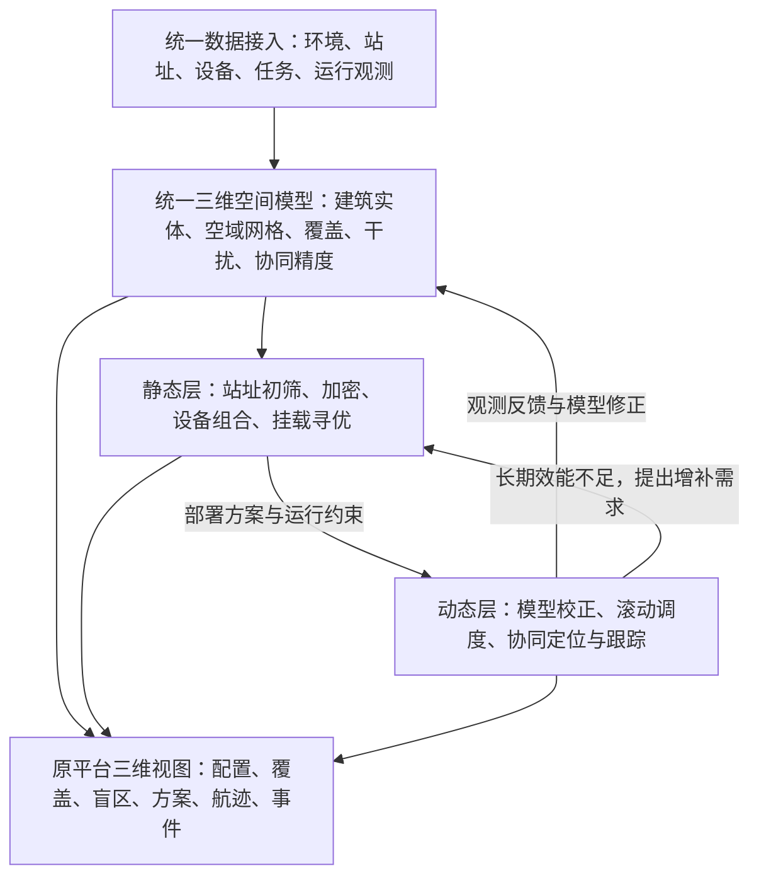

# 静态与动态两层规划设计

日期：2026-10-07  
范围：沿原申请书完善子项目三、四，保留四项核心问题、五个子项目及原考核指标。

依据：[子项目四平台设计](../../申报/子项目四_平台设计与关键技术.md)、[申请书原文提取](../../答辩ppt/figs/dsh/_raw/申报书全文.txt)、[平台规划与设计](平台规划与设计.md)。申请书子项目三给出站址初筛、加密与联合寻优路线；子项目四给出模型修正、动态优化、协同定位跟踪与平台闭环。

## 1. 总体结构

建设“统一三维空间模型＋静态建网规划＋动态运行优化”。静态层决定网怎么建；动态层决定既有网络如何随目标、任务和设备状态变化而调整。两层共用模型、数据和原平台三维视图。

## 2. 静态层：可建设、可验证的网络方案

回答“站址选哪里、设备怎么配、挂载怎么调、协同怎么组”。

| 功能 | 输入与处理 | 输出 |
|---|---|---|
| 环境与资源建模 | 地形、建筑实体、通信塔、楼顶、杆塔；供电、回传、承重、安装条件 | 工程可用候选站址库 |
| 覆盖与效能计算 | 设备模型、遮挡、天气、干扰、多站观测几何 | 覆盖、发现概率、SINR、定位精度场 |
| 站址初筛 | 加权贪心预筛选、整数规划精修 | 满足约束的初期站址集合 |
| 效能残差与加密 | 识别未覆盖、精度不足、航路覆盖不连续区域 | 补站、补设备及加密建议 |
| 联合参数寻优 | 设备组合、安装高度、安装方位、俯仰与协同配置 | 完整部署方案 |
| 对比与归档 | 相同环境、任务、指标下比较原配置与候选方案 | 站址表、设备表、工参表、成本及效能报告 |

保留申请书目标：低空监测空间覆盖率≥90%，重点核心区≥95%。定位精度、预算及关键航路要求作为可配置约束。未满足时明确显示缺口和原因。每份方案保存环境、设备模型和计算参数版本，支持复现。

## 3. 动态层：维持既有网络感知能力

以已确认静态方案为基础。安装位置、挂高作为部署配置；只有实际具备转动或扫描能力的设备才能调整运行指向。

| 功能 | 触发条件与处理 | 输出 |
|---|---|---|
| 运行数据汇聚 | 观测、航迹、信号质量、干扰、设备状态；时间与质量治理 | 运行状态与有效观测 |
| 模型在线校正 | 预测与实测存在系统性偏差时修正噪声、衰减和遮挡参数 | 带版本模型及验证结果 |
| 滚动资源优化 | 热点、任务优先级、负载或设备状态变化；重算指向、周期、模式、协同站和计算分配 | 带有效时间的策略 |
| 故障补位 | 设备故障、链路中断或局部效能下降 | 备用节点切换、邻站协作及剩余缺口 |
| 定位跟踪与预警 | 联合定位、跨站接续、身份关联及行为分析 | 航迹、不确定度、异常事件 |
| 执行与反馈 | 策略下发、回执、实际效果对比 | 执行记录与下一轮调整依据 |

遵循申请书状态—任务—资源图模型和滚动时域优化路线。长期效能不足才反馈静态增补需求。合作飞机仅在有效飞行窗口内贡献临时观测，窗口结束撤出，不永久计入站址或覆盖。

## 4. 统一空间与数据设计

| 对象 | 核心设计 |
|---|---|
| 空间模型 | 统一地理原点与局部东、北、天坐标；显示和遮挡计算使用同份建筑几何 |
| 三维网格 | 广域≤10 m、核心区≤2 m；分区加载、分块计算 |
| 网格结果 | 可见设备/模态、遮挡、发现概率、干扰、精度；区分未计算与盲区 |
| 静态方案 | 站址、设备组合、安装工参、建设成本、验算结果 |
| 动态状态 | 时间、在线状态、运行指向、任务、链路、负载、航迹 |
| 版本关联 | 环境版本、部署方案、模型版本、运行时间窗与输入数据来源 |

点击盲区应能追溯：哪些设备本可观测、被什么遮挡、是否受干扰影响、补点或调度能改善什么。预测结果与实际观测分别保存，保留模型修正历史。

## 5. 原平台页面流程

沿用原页面，在网络规划中明确静态、动态两项操作，共用场景和三维视图。

- 感知诊断：覆盖、盲区、干扰、精度；单站与多站贡献。
- 网络规划／静态规划：预算及约束→初筛→加密与工参寻优→前后对比→确认部署版本。
- 网络规划／动态优化：部署版本及任务时间窗→运行状态→滚动策略→回放验证→执行记录。
- 风险态势：动态层航迹及事件，追溯观测来源。
- 验证与研究贡献：预测与实测差异、方案对照、算法基线、指标及证据。

三维支持当前配置／候选方案对比、单站／多站覆盖、盲区与精度不足区、安装朝向与运行指向、目标航迹、时间回放及跨站接续。候选方案预览与已应用配置显式区分。

## 6. 实施顺序和完成标准

| 阶段 | 内容 | 完成标准 |
|---|---|---|
| 1 | 合并覆盖和工程计算口径，统一遮挡、坐标、版本 | 同一点显示、遮挡判断与计算结果一致 |
| 2 | 静态初筛、加密、联合寻优、方案前后对比 | 可复现部署方案，解释剩余缺口 |
| 3 | 状态接入、时间回放、滚动优化、故障补位、跨站协同 | 同一部署下比较固定策略与动态策略 |
| 4 | 实际设备接入、模型校正、策略回执、示范评估 | 预测、观测、调整与执行结果可追溯 |

第一阶段优先解决现有两套覆盖模型和网格口径差异。50 m数值基线不等同申请书10 m／2 m目标；合成场景不作为实测达标证明。

## 7. 本轮平台完善（实现范围）

1. 原网络规划页面明确静态补点与动态航路推演；沿用已有计算基线。
2. 静态方案增加同网格当前／方案／变化覆盖对比，支持二维和三维，保留版本校验；预览不写入设备配置。
3. 动态航路推演补充完整站址表、分段策略、目标位置、可见站点与三维航路预览；指向和扫描周期为策略草案，不代表设备执行回执。
4. 场景或设备版本变化后清除旧推演与对比，避免旧结果覆盖新场景。

本轮没有实现整数规划精修、完整挂载联合寻优、实测在线校正、滚动优化或真实设备策略下发。这些仍按上述阶段推进。

## 8. 固定部署与故障对照（2026-10-07 补充）

原网络规划页面的动态层默认使用“固定当前部署”：不增加站址、不产生建设费用，按当前部署评估航路观测机会并生成分段协同草案。“航路补站对照”保留原有贪心增补方法，用于反馈静态建设需求。

可选择一台当前设备模拟故障，比较故障前后航路覆盖率、最长观测缺口、可见站与协同组合。故障只影响本次推演，不修改部署台账。接口新增 `fixed_network`（默认 true）和 `offline_ids`，未知设备返回 422。已应用的候选设备继续参与后续评估。

这里的故障对照与分段策略属于离线评估，不等同自动故障恢复或滚动资源优化；覆盖站数不代表定位精度。下一步应在设备运行能力约束下加入时间窗、扫描负载和跨站接续目标，并用固定策略作对照。
